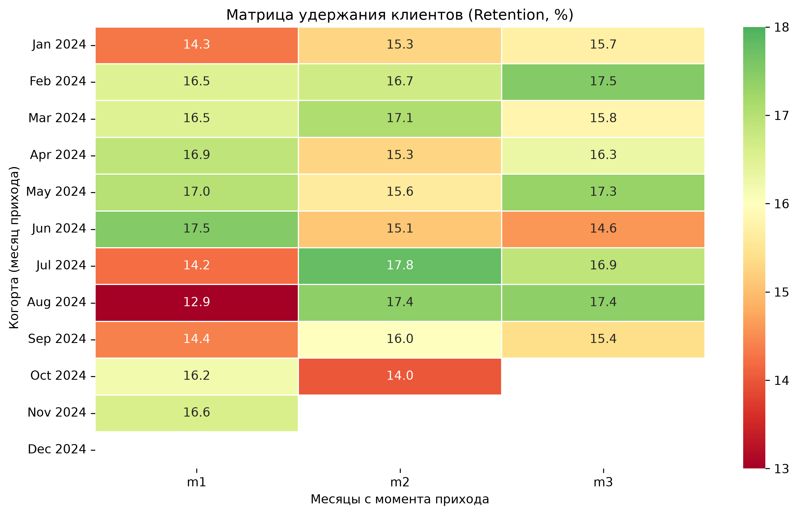
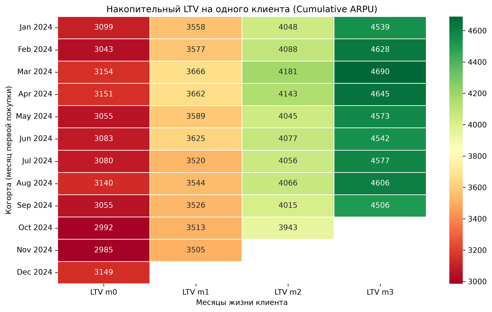

# Когортный анализ клиентов E-commerce (Retention & LTV)

## 📌 О проекте
В рамках проекта проведен когортный анализ клиентской базы интернет-магазина на основе логов пользовательских событий (320 000 записей). Главная цель — оценить качество удержания клиентов (Retention Rate) и динамику их монетизации (Cumulative LTV) в разрезе месяцев привлечения.

**Данные:** [Kaggle](https://www.kaggle.com/datasets/yashch05/user-event-funnel-and-retention-analytics-dataset) *(Файл также прикреплен в репозитории)*

## 🛠 Стек и инструменты
* **SQL (DuckDB):** расчет когорт первой покупки, определение разницы в месяцах, построение матриц удержания и выручки с использованием условной агрегации (`FILTER WHERE`).
* **Python (Pandas, NumPy):** предобработка данных, расчет относительных показателей и накопительного ARPU.
* **Визуализация (Matplotlib, Seaborn):** построение тепловых карт (Heatmaps) с маскировкой будущих периодов.

## 📊 Ключевые результаты и инсайты

### 1. Удержание клиентов (Retention Rate)

* **Стабильный рост весной:** Когорты февраля–июня продемонстрировали наилучшее удержание на первый месяц (`m1`) — **16.5% – 17.5%**.
* **Летняя просадка:** Начиная с июльской когорты зафиксировано резкое снижение возвратов — до **14.2%** в июле и **12.9%** в августе.

### 2. Накопительная ценность клиента (Cumulative LTV)

* **Базовый чек (`LTV m0`):** Средний доход с одного нового покупателя в первый месяц стабилен на протяжении всего года и составляет **2 985 – 3 154** у.е.
* **Рост ценности (`LTV m3`):** За три месяца жизни накопительный доход с клиента вырастает в среднем на **48–50%** и достигает **4 506 – 4 690** у.е. (пик у мартовской когорты).
* **Компенсация оттока:** Несмотря на падение удержания летом, итоговый `LTV m3` июльской и августовской когорт не уступает весенним значениям за счет более высокого среднего чека повторных покупок.

## 💡 Бизнес-рекомендации
1. **Масштабирование каналов привлечения:** Изучить рекламные кампании и источники трафика февраля–апреля для тиражирования успешных механик.
2. **Аудит летнего трафика:** Проверить качество трафика и возможные технические проблемы в июле–августе, чтобы выявить причины снижения частоты возвратов.
3. **Развитие программы лояльности:** Внедрить триггерные коммуникации и бонусы на второй заказ в течение первых 30 дней, так как повторные покупки в `m1–m3` формируют почти половину стартовой выручки.

## 📁 Структура репозитория
* `Cohort_Analysis.ipynb` — основной Jupyter Notebook с SQL-запросами, расчетами, визуализацией и подробными выводами.
* `requirements.txt` — список зависимостей для запуска проекта.
* `retention_heatmap.png` — график матрицы удержания.
* `ltv_heatmap.png` — график матрицы LTV.
* `README.md` — описание проекта и ключевые выводы.

## ⚙️ Как запустить проект
1. Клонируйте репозиторий.
2. Установите зависимости: `pip install -r requirements.txt`.
3. Откройте файл `Cohort_Analysis.ipynb` и запустите все ячейки.